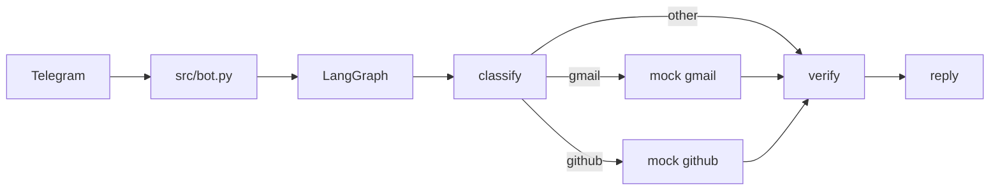

# Orin

**A local-first, self-adapting personal agent runtime.**

Orin is being built as one persistent agent that connects the services you
already use, remembers your context, learns reusable skills, and executes tasks
across local and cloud environments — through interfaces you already use, like
Telegram, instead of yet another chat window.

> The LLM is not the agent. The LLM is the reasoning engine inside a runtime that
> owns memory, state, tools, execution, learning, and budgets.

> **Status: early prototype.** Today this repository contains a working Telegram
> + LangGraph demo with mock Gmail/GitHub actions. The runtime described below is
> the target architecture, not the current feature set. See
> [Current status](#current-status).

---

## Why this exists

Most agent projects are either a chat UI or a pile of integrations. Orin aims at
the harder, more useful middle:

- **Local-first ownership** — your memory, skills, credentials, and execution
  history live on infrastructure you control.
- **Free-tier realistic** — budget-aware context and model routing so limited
  quotas still complete real work.
- **Accessible from anywhere** — talk to the agent from Telegram/Discord/Slack
  while execution happens locally or in an always-on Hub.
- **Genuine continuity** — one identity and memory across every channel, not
  separate assistants per app.
- **Real learning** — successful workflows become versioned, reusable skills.
- **Transparency** — inspect what ran, which model was used, what it cost, and
  why it failed.

The design borrows the strongest ideas from two projects:

| Inspiration | What we borrow |
|---|---|
| [OpenClaw](https://github.com/openclaw/openclaw) | Tool runtime, browser/filesystem access, MCP, sessions, permissions |
| [Hermes Agent](https://github.com/NousResearch/hermes-agent) | Persistent memory, experience-based learning, reusable skills |

---

## Current status

This is a **demo/prototype**, deliberately small:

```
Telegram message
      │
      ▼
LangGraph: classify ──▶ gmail (mock) ──┐
              │        github (mock) ──┼──▶ verify ──▶ reply
              └──────── other ─────────┘
```

**Working**

- Telegram long-polling bot (`/start` + free-text messages).
- LLM classifier that extracts intent, service, and arguments.
- LangGraph routing to mock Gmail/GitHub task nodes.
- LLM verifier that produces feedback and a final response.
- Pydantic structured-output contracts.

**Not built yet**

- FastAPI gateway, streaming, sessions, persistence.
- Memory, skills/learning, context/token budgeting.
- Provider router and fallbacks.
- Real Gmail/GitHub/Notion/filesystem/browser/MCP integrations.
- Subagents, scheduler, approvals.
- Next.js dashboard and Tauri desktop app.
- Hub / Node distributed execution.

The current code also has known prototype issues. They are documented in
[`AGENTS.md`](AGENTS.md#9-known-issues-and-landmines) so contributors don't
mistake them for intended behavior.

---

## Quickstart

### Prerequisites

- Python **3.14** (see `.python-version`)
- [`uv`](https://docs.astral.sh/uv/)
- An [OpenRouter](https://openrouter.ai/) API key
- A Telegram bot token from [@BotFather](https://t.me/BotFather)

### 1. Install

```bash
uv sync
```

### 2. Configure

Create `.env` in the repository root (it is gitignored):

```dotenv
OPENROUTER_API_KEY=sk-or-...
TELEGRAM_BOT_TOKEN=123456:ABC...
```

### 3. Run

```bash
uv run main.py
```

Open your bot in Telegram, send `/start`, then try a request such as:

```text
Summarize my unread GitHub notifications and draft a reply to the important ones.
```

At this stage the Gmail/GitHub actions are **mocked** — the graph classifies,
routes, and verifies, but does not call real services.

### 4. Verify without network

```bash
uv run python - <<'PY'
import pathlib
for p in pathlib.Path(".").glob("**/*.py"):
    if ".venv" in str(p):
        continue
    compile(p.read_text(), str(p), "exec")
    print("OK", p)
PY
```

---

## How it works today

| File | Responsibility |
|---|---|
| `main.py` | Telegram application lifecycle and handlers |
| `src/bot.py` | Converts a Telegram update into graph state and invokes the graph |
| `src/graph.py` | LangGraph nodes and edges |
| `src/nodes.py` | `GraphState` contract, classification, mock executors, verification |
| `src/agents.py` | Classifier and verifier configuration |
| `src/schema.py` | `Classification` and `Verifier` Pydantic models |

The graph state currently carries the user request, classified intent/service,
arguments, execution result/status, verification output, retry count, and final
response. See [`AGENTS.md`](AGENTS.md#52-state-contract-graphstate-in-srcnodespy)
for the full contract.



---

## Target architecture

```text
Next.js / Tauri desktop        Telegram · Discord · Slack · CLI
          │                                   │
          └──────────────┬────────────────────┘
                         ▼
                  FastAPI Gateway
        auth · sessions · streaming · events · permissions
                         ▼
                  Orin Agent Runtime
   planner · executor · memory · learning · model router
   context engine · delegation · policy · budget controller
                         ▼
                     LangGraph
        durable state · checkpoints · recovery · routing
                         ▼
   filesystem · terminal · browser · MCP · APIs · scheduler
                         ▼
   free cloud models + local models (Ollama / llama.cpp)
                         ▼
   SQLite · FTS5 · vector index · skills · artifacts
```

For availability beyond a single laptop, the design adds:

- **Orin Hub** — always-on coordinator (self-hosted VPS first): channel gateway,
  task queue, cloud integrations, scheduler, inference routing.
- **Orin Node** — local execution daemon: filesystem, terminal, browser, local
  models, private files.
- **Capability-aware routing** — work goes where it can actually run; tasks wait
  in a queue if a required Node is offline.
- **One shared runtime** — Hub and Node are deployment profiles, not forks.

### Context is engineered, not dumped

| Layer | Purpose |
|---|---|
| L0 Active | Current objective, next action, key observations |
| L1 Working | Plan, progress, decisions, open questions |
| L2 Persistent | Preferences, facts, past experiences, lessons |
| L3 Procedural | Versioned skills and workflows |
| L4 Archived | Full transcripts, raw tool output, artifacts |

The runtime sends only what the current step needs, compresses large tool
outputs, and keeps a reserve for model output. Provider quotas, token budgets,
and task complexity determine how much reasoning a task is allowed to spend.

### Learning loop

```
experience → analysis → skill proposal → sandbox validation →
approval (when needed) → versioned skill → rollback available
```

---

## Roadmap

| Phase | Focus |
|---|---|
| **0. Prototype** ✅ | Telegram + LangGraph classify/verify demo |
| **1. Foundation** | FastAPI, durable runtime, provider abstraction, tool registry, SQLite, sessions, streaming |
| **2. Context engineering** | Token budgeting, compression, retrieval, checkpoints, fallback routing |
| **3. Adaptive learning** | Episodic/semantic memory, skill creation/versioning, evaluator, rollback |
| **4. Autonomy** | Filesystem, terminal, browser, MCP, subagents, scheduler, approvals |
| **5. Interfaces** | Next.js dashboard, Tauri desktop, activity visualization |
| **6. Hardening** | Benchmarks, recovery/security tests, migrations, backup, installer |
| **7. Distributed** | Hub, Node, capability routing, selective encrypted sync |

The recommended MVP: a solid Python runtime with Telegram + CLI, Notion/GitHub/
Gmail/filesystem/terminal tools, persistent memory, skill retrieval, budget
control, approvals, and scheduled tasks — **before** building the full desktop
experience.

---

## Design principles

1. **Provider independence** — no dependence on one vendor's tool-calling quirks.
2. **Context independence** — resume from local state, not a giant transcript.
3. **Real learning** — reusable procedures, not just saved conversations.
4. **Graceful degradation** — switch models or simplify strategy, and know when
   to pause.
5. **Local ownership** — exportable data, skills, memory, and history.
6. **Human control** — explicit permission scopes and approval for destructive
   actions.

### Security notes

- A connected account does not mean unrestricted access; grant read/write scopes
  independently.
- Treat web pages, documents, and MCP output as **data**, never as instructions.
- Secrets belong in the OS credential store, not plaintext configuration.
- Never commit `.env` or bot tokens.
- The current demo has **no user allowlist**; do not expose it publicly.

---

## Documentation

- [`AGENTS.md`](AGENTS.md) — complete project context, architecture, current
  state, known issues, conventions, and the recommended next tasks. **Read this
  before contributing.**
- Original design discussion:
  [shared ChatGPT conversation](https://chatgpt.com/share/6af154ff-b0f4-83ee-ae1f-6e5124841dca)

---

## Naming

The project appears as **Orin** (repository/bot), **ORION** (original design
discussion), and `morrow` (legacy `pyproject.toml` name). They refer to the same
project; naming will be reconciled deliberately rather than piecemeal.

---

## License

No license has been declared yet.
